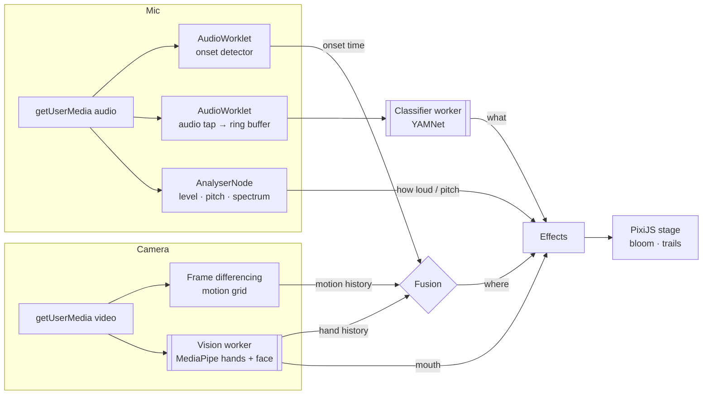

# SoundSight

**Make a sound in front of your webcam and watch it light up where it came from.**

Clap and a shockwave bursts between your palms. Snap and lightning crackles off your fingertips. Talk and your own waveform ripples out of your mouth. Everything runs live in the browser, on your device.

<!-- Record a 10–15 s screen capture (clap, snap, knock, talk, whistle) and save it as docs/demo.gif -->


**[Live demo →](https://mellifluous-nougat-5d08df.netlify.app)** · Chrome, Edge, Firefox or Safari · needs a webcam and microphone

---

## The problem, and the trick

A laptop has one microphone channel, and one channel can't tell *where* a sound came from. Locating a sound by audio alone needs an array of spaced-out mics.

SoundSight works the way people do: **the ears say *when* and *what*, the eyes say *where*.**

| Question | Answered by | How |
|---|---|---|
| **When** did a sound happen? | Microphone | Transient (onset) detection in an `AudioWorklet`, ~10 ms after the sound |
| **What** was it? | Microphone | Google's YAMNet audio classifier (521 sound classes) mapped to clap / snap / knock / voice / whistle / music |
| **Where** did it come from? | Camera | MediaPipe hand and face tracking: palms closing in means a clap, fast fingertips mean a snap, the mouth for voice. Frame-differencing motion is the fallback. |

## Every sound has its own look

| Sound | Visual |
|---|---|
| Clap | Shockwave: screen flash, camera shake, blast rings and spray |
| Snap | Lightning bolts crackling from the fingertips |
| Knock | Ripples across a surface, with droplets splashing up and falling back |
| Voice | Your live waveform wrapped into rings leaving your mouth; colour follows your pitch |
| Whistle | Music notes floating up, tinted by the note you whistle |
| Music | A live spectrum equalizer along the bottom of the screen |

Four looks (**Neon**, **Dreamy**, **Minimal**, **Party**) adjust glow (bloom), motion trails, intensity and screen shake. Your choice is saved locally.

## How it works



1. **Onset detection** ([`onsetDetector.ts`](src/audio/onsetDetector.ts)) runs on the audio thread. It compares a 2 ms and a 300 ms energy envelope of the high-passed signal and timestamps each transient on the audio clock, so it can be matched against camera frame times.
2. **Localization** looks back ~400 ms from the onset:
   - [`handLocalize.ts`](src/fusion/handLocalize.ts): did the palms converge (measured in hand-widths, so it doesn't depend on distance from the camera)? Then it's a clap at their meeting point. Otherwise, the fastest-moving fingertips.
   - [`localize.ts`](src/fusion/localize.ts): fallback when no hands are tracked. It time-weights the motion grids and scores each cell by *motion × compactness*, so hand-sized movement beats a moving head or torso.
3. **Classification** ([`classifier.ts`](src/audio/classifier.ts)) runs YAMNet on the last 0.975 s, both 150 ms after each onset (to restyle the burst) and every 250 ms (to drive the continuous voice, whistle and music effects).
4. **Rendering** ([`stage.ts`](src/visuals/stage.ts)) uses PixiJS: batched particles with one shared texture, rings, lightning, glyphs and an equalizer, drawn into a ping-pong render-texture feedback loop for trails, with an `AdvancedBloomFilter` on top.

### Performance

- **ML in Web Workers.** Hand, face and sound models run off the main thread. The GPU shader compile on first load (several seconds on a cold cache) used to freeze the UI; now the longest main-thread stall while all three models load is ~65 ms.
- **Backpressure.** Only one camera frame is in flight to the vision worker at a time, so slower devices drop frames instead of queueing them.
- **No per-frame allocation on hot paths.** Particles are recycled through a `ParticleContainer`, and audio is moved in 2048-sample chunks rather than 128-sample render quanta.
- On an Apple M3: hands ~7 ms, face ~2 ms (every other frame), YAMNet ~20 ms (4×/s), motion ~2 ms/frame.

## Run it locally

```bash
npm install
npm run dev      # http://localhost:5173
npm test         # 56 unit tests (Vitest)
npm run build
```

Camera access needs `localhost` or HTTPS. Press **Look** (bottom right) for visual presets. The debug panel (top left) shows per-model timings, the live classification, a motion heatmap and hand/face landmarks.

## Project structure

```
src/
  audio/    onset detection, audio tap + ring buffer, features (pitch, spectrum), YAMNet worker
  vision/   camera, motion grid, MediaPipe vision worker, hand/face trackers
  fusion/   where did the sound come from? (hands, then motion)
  visuals/  PixiJS stage, per-sound effects, looks/presets
  ui/       permission screen, settings and debug panels
```

Pure logic (onset detection, motion math, localization, classification mapping, audio features, presets) is kept DOM-free and unit tested. Synthetic signals stand in for real claps, tones and moving hands.

## Limitations

- One sound source at a time; with several people the heuristics pick the strongest candidate.
- Sounds from off-screen (a door behind the camera) fall back to the centre of the frame.
- YAMNet sees ~1 s windows, so the class-specific styling arrives ~150 ms after the instant burst.

## Privacy

Audio and video never leave the device. The only network requests are for the model files (Google's MediaPipe model storage) and the MediaPipe WebAssembly runtime (jsDelivr).

## Built with

React · TypeScript · Vite · Web Audio API (AudioWorklet) · MediaPipe Tasks (Hand Landmarker, Face Landmarker, Audio Classifier / YAMNet) · PixiJS 8 · pixi-filters · Vitest
